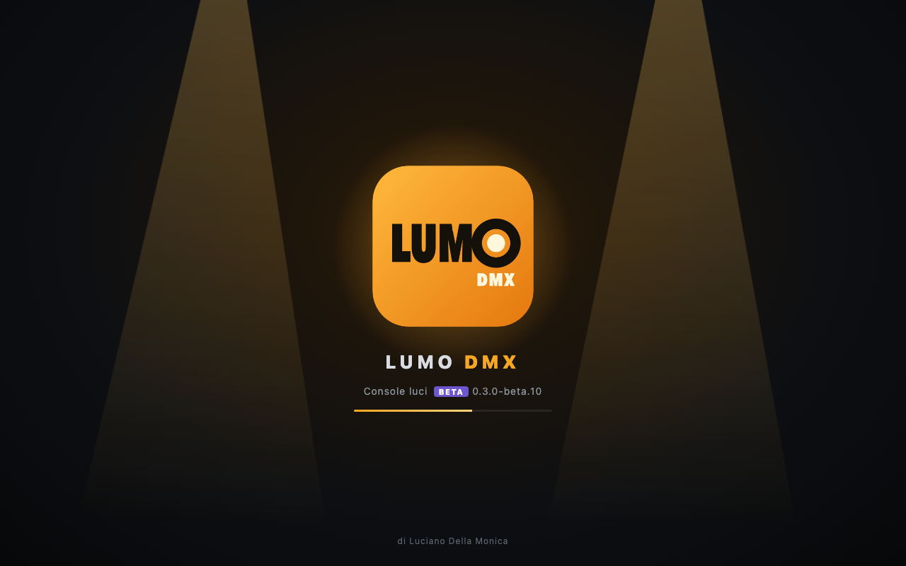
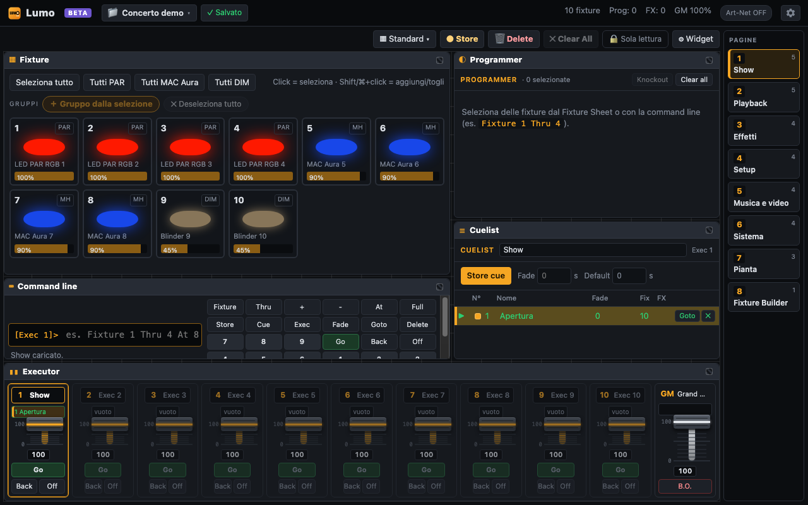
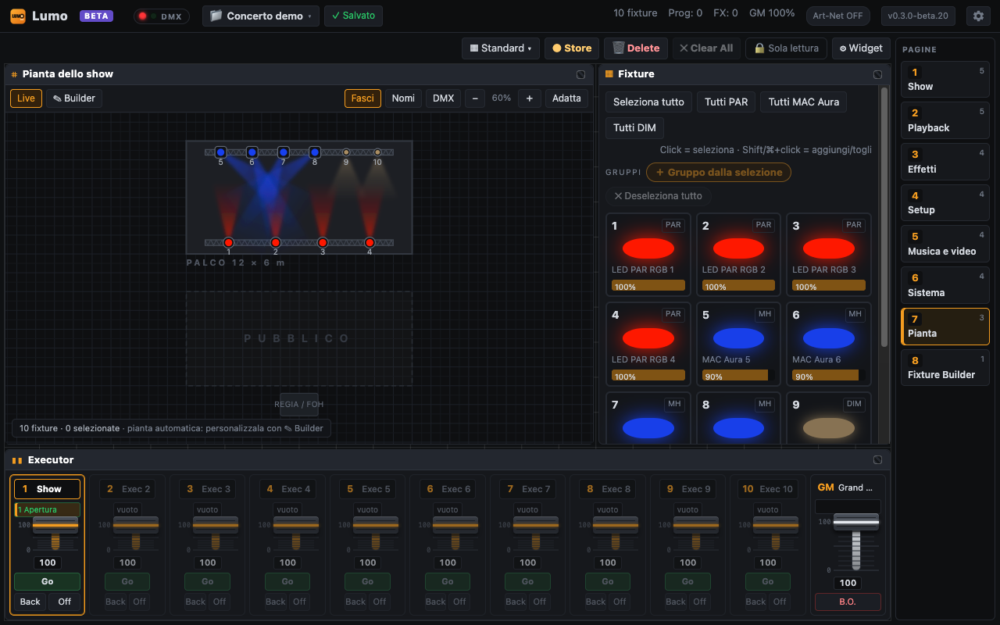
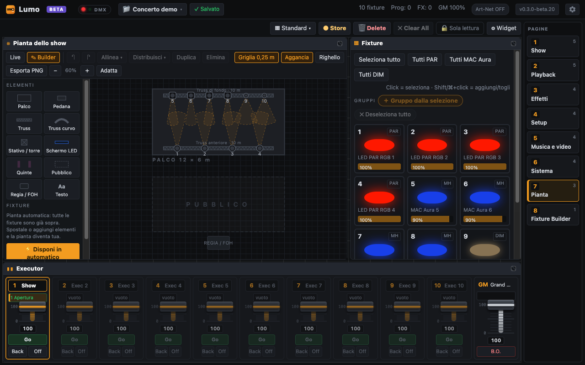
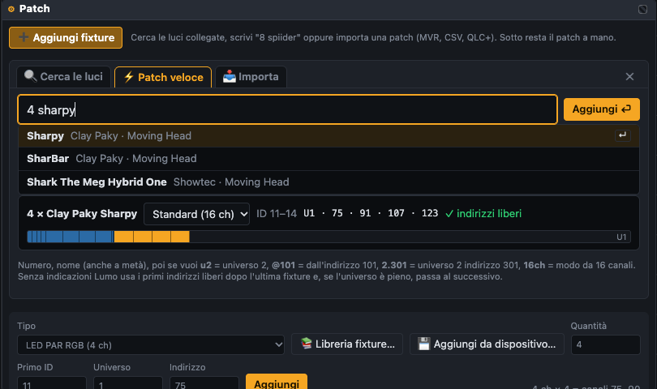
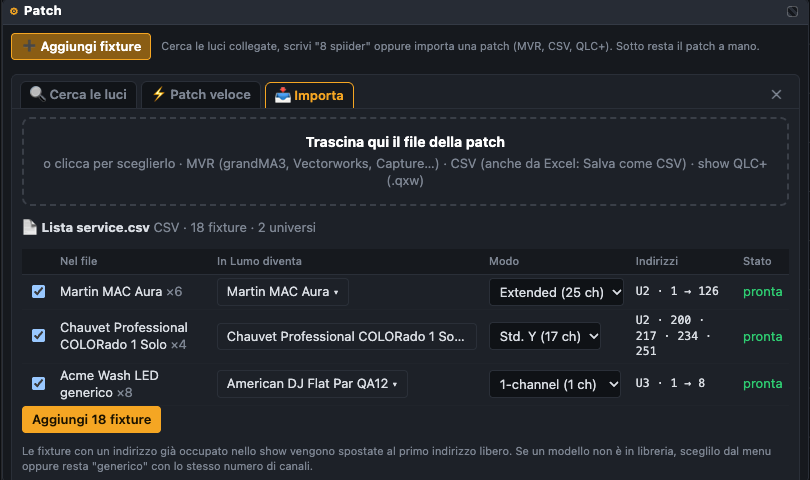
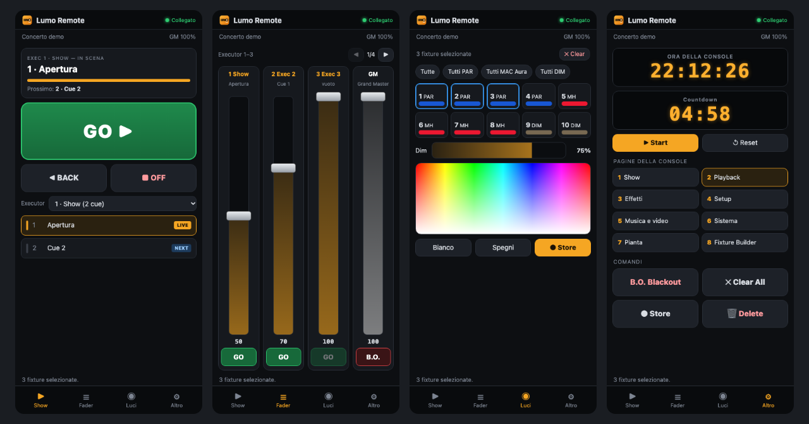
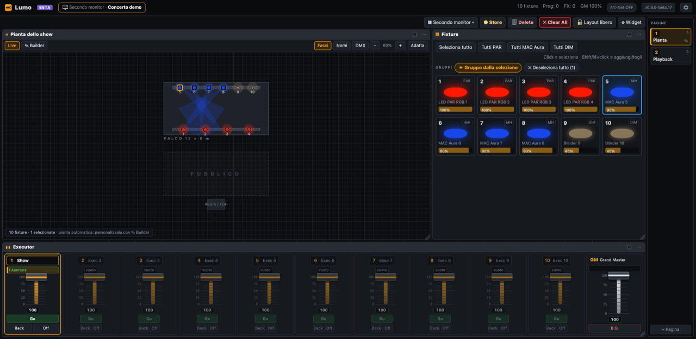
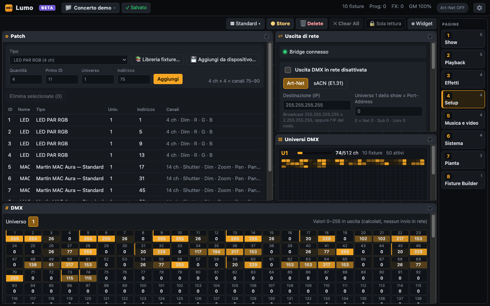
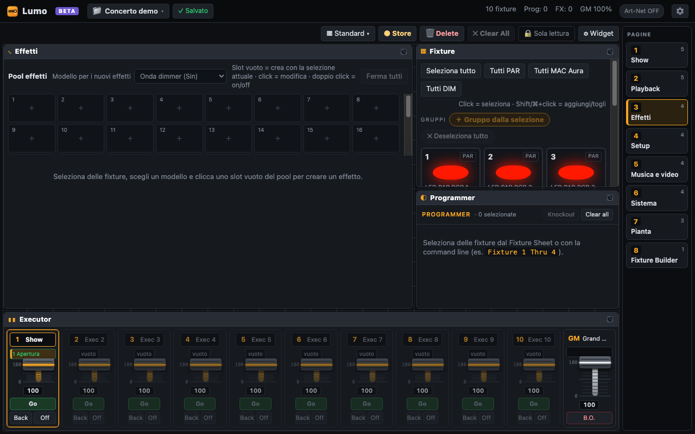

# Lumo

**Console luci software per Mac e Windows** — programmazione, playback e uscita DMX su Art-Net, sACN e interfacce USB.

> Lumo è in **beta** (versione attuale: 0.3.0-beta.22). Questa pagina presenta il programma: il codice sorgente non è pubblico.

*[English below](#english)*

---

## Cosa fa

- **Patch e libreria** — oltre **2.200 fixture** di più di 200 produttori (Martin, Robe, Clay Paky, Chauvet, ADJ, Elation, Ayrton…), import di file GDTF e Open Fixture Library, **Fixture Builder** per creare le tue.
- **Patch automatica** — *Cerca le luci* le trova da sole con **RDM** (nodi Art-Net e interfacce USB Enttec Pro); *Patch veloce*: scrivi "8 sharpy" e Lumo trova modello, modo e indirizzi liberi; *Importa* una patch da **MVR**, CSV o QLC+.
- **Programmer e command line** — intensità, colore, posizione, gruppi, comandi come `Fixture 1 Thru 4 At 80`.
- **Cue ed executor** — 10 executor con fader, Go, Back e Off, fade, tracking, colori dei cue, **Store** e **Delete** come sulle console.
- **Effetti** — pool di effetti con editor a righe (dimmer, colore, movimento).
- **Pianta dello show** — vista 2D con colori, intensità e **fasci** reali, più un builder per disegnare palco, truss e pubblico.
- **Uscita DMX** — Art-Net, sACN e interfacce USB (Enttec DMX USB Pro e compatibili, Open DMX), fino a 4 universi, con **LED del segnale** sempre visibili.
- **Telecomando dal telefono** — *Lumo Remote*: GO, fader, luci e countdown dal browser del telefono, protetto da PIN.
- **Secondo monitor** — una seconda finestra a tutto schermo collegata allo stesso show in diretta.
- **Aree di lavoro** — pagine e widget liberi (orologio, countdown, note, audio, video, MIDI…); all'avvio si riapre l'ultima area usata.
- **E poi** — controller MIDI, Desk Lock, salvataggio automatico, aggiornamenti automatici firmati, tutorial al primo avvio.

## Immagini

| | |
|---|---|
|  |  |
| *Pianta dello show: colori e fasci in tempo reale* | *Builder: palco, truss e pubblico* |
|  |  |
| *Patch veloce: "4 sharpy" e gli indirizzi sono pronti* | *Importa: la lista del service abbinata alla libreria* |
|  |  |
| *Lumo Remote sul telefono* | *Secondo monitor: Pianta e Playback* |
|  |  |
| *Setup: patch, uscita di rete, universi DMX* | *Pool effetti ed editor* |

## Manuale

- 📘 [Manuale utente (italiano, PDF)](manuale/Lumo-Manuale-IT.pdf)
- 📗 [User manual (English, PDF)](manuale/Lumo-Manual-EN.pdf)

## Requisiti

- **Mac**: macOS 12 o successivo, processori Apple Silicon e Intel.
- **Windows**: Windows 10 o 11 (64 bit).
- Per l'uscita DMX: un nodo Art-Net / sACN in rete oppure un'interfaccia USB-DMX.

## Riconoscimenti

La libreria fixture usa i dati di [Open Fixture Library](https://open-fixture-library.org) (licenza MIT) e di [QLC+](https://www.qlcplus.org) (licenza Apache 2.0).

## Licenza

© 2026 Luciano Della Monica. **Tutti i diritti riservati.** Vedi [LICENSE](LICENSE.md).

---

## English

**Lumo is a software lighting console for Mac and Windows** — programming, playback and DMX output over Art-Net, sACN and USB interfaces. It is currently in **beta**; this page presents the program, the source code is not public.

Highlights: a library of 2,200+ fixtures, **automatic patching** (RDM discovery, quick patch, MVR/CSV/QLC+ import), programmer and command line, 10 executors with cues and fades, effects, a **2D show plot** with live beams, Art-Net/sACN/USB output with signal LEDs, a **phone remote** (PIN-protected), **second monitor** support, free workspaces with widgets, MIDI control, Desk Lock and automatic signed updates.

Manuals: [Italian](manuale/Lumo-Manuale-IT.pdf) · [English](manuale/Lumo-Manual-EN.pdf)

© 2026 Luciano Della Monica. All rights reserved.
